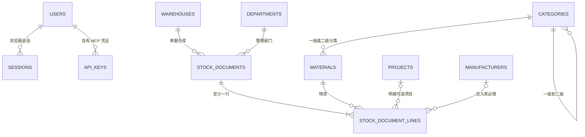

# only-stock·数据模型与实体约束

> 文档版本：1.0 ｜ 文档状态：现行有效
> 所属系统：only-stock（单一公司内网；Python 全栈、单一 SQLite、Docker Compose）
> 本文职责：定义账户与业务数据表、实体关系、分类物资、单据、数量精度及基础资料状态约束。
> 导航：[文档索引](00-文档索引与阅读指南.md) ｜ [术语与总体约束](01-项目概览与范围.md#14-关键术语)

---

## 6. 数据模型与实体关系

### 6.1 账户与会话表

所有主键使用 UUID 字符串；时间存 UTC RFC 3339 文本或统一 epoch 毫秒，整个代码库只能选择一种实现并在代码中统一转换。

| 表           | 关键字段                                                                                                                                                                        | 主要约束                                                                                           |
| ------------ | ------------------------------------------------------------------------------------------------------------------------------------------------------------------------------- | -------------------------------------------------------------------------------------------------- |
| `users`    | `id`, `login_name`, `password_hash`, `display_name`, `role`, `status`, `force_password_change`, `password_version`, `version`, `created_at`, `updated_at` | 规范化登录名唯一；角色仅 `COMPANY_ADMIN/OPERATOR`；不物理删除                                    |
| `sessions` | `id_hash`, `user_id`, `csrf_hash`, `created_at`, `last_seen_at`, `absolute_expires_at`, `revoked_at`                                                              | 会话哈希唯一；用户外键；清理过期记录                                                               |
| `api_keys` | `id`, `user_id`, `name`, `key_hash`, `key_suffix`, `created_at`, `last_used_at`, `revoked_at`, `revoke_reason`                                                | Key 哈希唯一；用户外键；不保存明文和角色；每用户最多 10 条 `revoked_at IS NULL` 记录；不物理删除 |

### 6.2 业务数据表

| 表                       | 关键字段                                                                                                                                                           | 主要约束                                                                                                                                                                                           |
| ------------------------ | ------------------------------------------------------------------------------------------------------------------------------------------------------------------ | -------------------------------------------------------------------------------------------------------------------------------------------------------------------------------------------------- |
| `warehouses`           | `id`, `code`, `name`, `location`, `is_active`, `version`, 时间字段                                                                                     | `code` 由系统自动生成、唯一且不可修改；`name` 去首尾空白后非空且唯一（唯一索引覆盖停用记录）                                                                                                   |
| `departments`          | `id`, `code`, `name`, `is_active`, `version`, 时间字段                                                                                                   | `code` 由系统自动生成、唯一且不可修改；`name` 去首尾空白后非空且唯一（唯一索引覆盖停用记录）                                                                                                   |
| `categories`           | `id`, `parent_id`, `code`, `name`, `level`, `is_active`, `version`, 时间字段                                                                         | `code` 由系统自动生成、唯一且不可修改；自引用父分类；`level` 仅 1 或 2；一级父为空，二级父必须为一级；一级分类名称全局唯一，二级分类名称在所属一级分类内唯一；存在未停用子分类或物资时禁止停用 |
| `materials`            | `id`, `code`, `category_id`, `name`, `unit`, `quantity_type`, `is_active`, `version`, 时间字段                                                     | `code` 由系统自动生成、唯一且不可修改；`(category_id, name)` 唯一；新增时必须选择启用的一级或二级分类，二级分类的父级也须启用；`unit` 必填；数量为 `INTEGER/DECIMAL`；创建后不可修改       |
| `projects`             | `id`, `code`, `name`, `is_active`, `version`, 时间字段                                                                                                   | `code` 由系统自动生成、唯一且不可修改；`name` 去首尾空白后非空且唯一（唯一索引覆盖停用记录）；创建后不可修改；停用后不可用于新关联                                                             |
| `manufacturers`        | `id`, `code`, `name`, `is_active`, `version`, 时间字段                                                                                                   | `code` 由系统自动生成、唯一且不可修改；`name` 去首尾空白后非空且唯一（唯一索引覆盖停用记录）                                                                                                   |
| `stock_documents`      | `id`, `doc_no`, `doc_type`, `warehouse_id`, `department_id`, `status`, `created_source`, `deleted_at`, `deleted_by`, `request_id`, `request_fingerprint`, 审计字段        | 下节详述；`(created_by, request_id)` 唯一；建立 `(created_by, request_fingerprint, created_at)` 索引供 MCP 窗口去重      |
| `stock_document_lines` | `id`, `document_id`, `line_no`, `material_id`, `manufacturer_id`, `project_id`, `quantity_milli`, `remark`, 快照字段                                                           | 下节详述                                                                                                                                                                                           |
| `document_counters`    | `biz_date`, `doc_kind`, `next_value`                                                                                                                         | 组合主键；在写事务内生成可读单号                                                                                                                                                                   |
| `code_counters`        | `entity_type`, `next_value`                                                                                                                                    | `entity_type` 主键；按六类基础资料分别计数，仅在写事务内生成实体 `code`                                                                                                                        |
| `audit_logs`           | `id`, `actor_user_id`, `action`, `entity_type`, `entity_id`, `before_json`, `after_json`, `request_id`, `source`, `api_key_id`, `created_at` | 仅追加；`source` 为 `WEB/API/MCP`，MCP 时记录非敏感 Key UUID，不记录完整凭证                                                                                                                   |
| `schema_migrations`    | Alembic 版本字段                                                                                                                                                   | 记录数据库迁移版本                                                                                                                                                                                 |

**六类实体编码统一规则**：`warehouses`、`departments`、`categories`、`materials`、`projects`、`manufacturers` 的实体编码字段均命名为 `code`。`code` 由服务端在创建事务内自动生成，页面、普通 API 和 MCP 创建工具均不提供输入入口，也不接受客户端传入；普通 API 收到 `code` 或旧实体字段名时按未知/只读字段返回 422，MCP 按协议返回参数校验工具错误，不得静默忽略后创建成功。

六类编码前缀统一使用对应中文名称的拼音首字母：仓库 `CK`、部门 `BM`、分类 `FL`、物资 `WZ`、项目 `XM`、厂家 `CJ`，后接固定 5 位、不足左补零的实体独立递增序号，例如 `CK-00001`、`WZ-00001`。序号达到 `99999` 后不得回绕或重复，创建应失败并返回明确错误，需扩展编码方案后方可继续。格式、前缀与补零规则由服务端统一维护，客户端不得自行拼接或依赖序号连续。编码生成、业务记录写入和计数器更新必须在同一 `BEGIN IMMEDIATE` 事务内完成，并以各表 `code` 唯一索引兜底并发写入；任一步失败均整笔回滚。`code` 创建后不可修改，记录停用或删除后不得回收复用。六类实体的详情、列表及嵌套摘要输出中，自有编码属性统一为 `code`。MCP 工具只以 `code` 和单据 `doc_no` 定位记录，创建工具返回系统生成的编码；工具输入输出不出现 `id`、`*_id` 或内部 UUID。

`parent_code`、`category_code`、`warehouse_code`、`department_code`、`project_code`、`material_code`、`manufacturer_code` 仅可作为跨实体关联或筛选的引用参数，分别表示对目标实体 `code` 的引用，不是目标表中的字段名，也不代表允许客户端指定新建实体的编码。

不建立 XLSX 解析批次、解析错误行或上传文件表；`stock_documents` 和 `stock_document_lines` 也不保存解析来源、原始文件名、文件哈希或跳过行信息。解析后保存的草稿与纯手工创建的草稿使用完全相同的数据结构。

### 6.3 实体关系



### 6.4 分类与物资

1. 一级分类没有父分类，二级分类必须指向一个一级分类，禁止第三级。
2. 物资必须归属一个一级或二级分类，不允许无分类物资。新增物资时，选择二级分类要求该分类及其一级父分类均启用，选择一级分类要求该分类启用；分类停用不改写既有物资归属或历史单据。
3. 物资 `code` 由系统自动生成，在物资表内唯一且不可修改，是稳定业务标识；数据库 UUID 是技术主键。
4. 分类和物资创建后不可修改。
5. 分类和物资名称在保存及查重前仅去除首尾空白，其余字符精确比较，不折叠大小写、不删除内部空白；停用记录仍参与查重并占用名称。一级分类名称在全系统唯一；二级分类名称在其所属一级分类内唯一，不同一级分类下允许同名；物资名称在其直接所属一级或二级分类内唯一，不同分类允许同名。
6. 名称唯一性由服务层校验和数据库唯一索引共同保证，以覆盖并发创建；重复名称返回 409 和明确错误代码，不得默认复用已有记录。`materials.code` 的自动生成与全局唯一规则按 6.2 执行，不接受用户输入。
7. 每种物资必须填写名称和计量单位。本期一个物资只有一个基础计量单位，不提供换算。
8. `quantity_type=INTEGER` 表示数量必须为整数；`DECIMAL` 表示允许最多三位小数，也允许录入整数。
9. 已关联出入库数据的分类、物资不可物理删除，只可停用；停用不改变历史。
10. 分类和物资停用后只影响入库；出库涉及的分类和物资由库存决定，不因停用而限制出库。

### 6.5 单据表约束

`stock_documents`：

- `doc_type`：`INBOUND` 或 `OUTBOUND`。
- `status`：`DRAFT` 或 `POSTED`。
- `warehouse_id`、`department_id`：始终必填。
- 单据头不保存备注；备注按明细行保存在 `stock_document_lines.remark`。
- `doc_no`：数据库内唯一，例如 `RK20261024-000001`、`CK20261024-000001`；不要求断号连续。
- `created_by`、`created_by_name`、`submitted_by`、`submitted_by_name`、`created_at`、`submitted_at`：记录制单和生效信息，其中显示名为历史快照。
- `version`：草稿乐观锁版本；提交时校验，防止覆盖他人修改。
- `created_source`：`WEB`、`API` 或 `MCP`，标识建单入口，创建后不可修改。MCP 窗口去重只对 `created_source = 'MCP'` 的记录生效，Web 与 API 建单不参与窗口去重。
- `request_id`：创建请求标识，与创建者组成唯一约束。Web 页面与 `/api/v1` 由客户端提供 UUID 作为幂等键，重试保持同一值；MCP `document_create` 由服务端为每次调用生成 UUIDv4，仅用于审计关联、日志和错误定位，不向模型暴露，也不参与去重判定。
- `request_fingerprint`：创建事务内根据[《MCP 服务与工具》7.9](08-MCP服务与工具.md#79-mcp-原子创建并提交)的规范化规则计算的请求内容指纹，使用 UTF-8 字节的 SHA-256 十六进制字符串保存；与 `request_id` 同时写入，不得由客户端提交或修改。该指纹同时是 MCP 建单窗口去重的依据；在创建事务内计算一次，草稿后续编辑不重算，提交生效后冻结。
- `deleted_at`、`deleted_by`：记录已生效单据软删除的时间和操作者；草稿沿用原删除方式，不使用软删除。软删除后保留单据及明细，但不计入库存汇总。
- 至少一条明细；同一单据内同一物资在同一项目（空项目视为同一取值）下只能出现一行；`line_no` 从 1 连续编号。

`stock_document_lines`：

- `quantity_milli > 0`，不使用负数量表示出库。
- `remark` 可空；保存前去除首尾空白，空字符串归一为 `NULL`，最多 500 字符。备注按行独立，不参与物资/项目唯一性判断、库存计算或单据头一致性判断。
- `project_id` 可空；非空时必须为数据库中启用的项目。同一单据的不同明细行可关联不同项目，也可部分留空。
- 数据库以 `(document_id, material_id, project_id)` 唯一索引兜底非空项目行，以 `(document_id, material_id)` 部分唯一索引兜底空项目行。
- 入库单的 `manufacturer_id` 必填且厂家启用；出库单必须为 `NULL`。
- 保存物资 `code`、名称、单位、数量类型及所属一级/二级分类名称快照；部门、厂家、仓库和项目保存显示名称快照或等价历史快照。
- 项目显示名称快照随明细保存：草稿每次保存时刷新，提交生效后冻结；已生效及已软删除单据按快照展示和导出。
- 对已生效单据，明细与单据头均禁止更新；只允许通过软删除标记整单删除，明细不物理删除。数据库触发器应作为服务层之外的第二道保护。

### 6.6 数量精确存储

SQLite 的 `NUMERIC(18,3)` 不能保证定点存储，因此统一使用：

```text
quantity_milli = round_half_up(decimal_quantity * 1000)
```

规则：

- 数据库类型必须为 `INTEGER`，应用禁止将浮点数直接传入转换函数。
- 输入先按字符串解析为 Python `Decimal`，再转换为千分比整数。
- 最多三位小数，第四位及以后即使为零也应按统一规则拒绝，避免隐式舍入。
- 整数物资要求 `quantity_milli % 1000 = 0`。
- 实际数量必须大于 0，最大为 `999999999999999.999`。
- 任一“仓库 + 物资”的库存余额不得超过 `MAX_BALANCE_MILLI = 9_000_000_000_000_000_000`（实际数量 `9000000000000000.000`）。该上限低于 SQLite 有符号 64 位整数上限，避免合法多行数据在 `SUM(quantity_milli)` 时溢出；提交和软删除均须在写事务内对本单涉及的全部物资校验，超过上限返回 409 `BALANCE_LIMIT_EXCEEDED`。
- JSON 数量使用不带科学计数法的十进制字符串，如 `"1.250"`。
- 页面展示和 API 输出由整数转换，不使用二进制浮点格式化。

### 6.7 基础资料删除与停用

| 数据       | 未引用                                   | 已引用                                 | 额外限制                                                                                                                                                                                                                                                                                                                                                               |
| ---------- | ---------------------------------------- | -------------------------------------- | ---------------------------------------------------------------------------------------------------------------------------------------------------------------------------------------------------------------------------------------------------------------------------------------------------------------------------------------------------------------------- |
| 仓库       | 可删除                                   | 仅停用                                 | 当前库存非零禁止停用；停用后可启用                                                                                                                                                                                                                                                                                                                                     |
| 物资       | 可删除                                   | 仅停用                                 | 停用后不可用于入库；出库由库存决定；停用后可启用，启用要求所属分类及一级父分类已启用                                                                                                                                                                                                                                                                                   |
| 部门、厂家 | 可删除                                   | 仅停用                                 | 停用后不可用于新单据；停用后可启用                                                                                                                                                                                                                                                                                                                                     |
| 分类       | 仅当无子分类、无物资且完全未引用时可删除 | 不满足删除条件时保留；已引用时仅可停用 | 一级分类有任一二级分类，或直接物资、任一后代分类中有物资时禁止删除；二级分类有直接物资时禁止删除；物资停用不影响挂载判定；同时仍须满足未被任何其他数据引用；停用不级联修改历史；停用后不可用于入库，出库由库存决定；**存在任一未停用的子分类或物资时禁止停用**（一级分类含全部后代未停用子分类及后代未停用物资）；停用后可启用，启用二级分类要求一级父分类已启用 |
| 项目       | 可删除                                   | 仅停用                                 | 停用后不可用于新增或提交的明细行，启用后可再次使用；被任一行（含草稿、已生效、已软删除）引用即仅可停用                                                                                                                                                                                                                                                                                                                                 |
| 用户       | 不物理删除                               | 禁用                                   | 历史单据保留用户 ID 和显示名                                                                                                                                                                                                                                                                                                                                           |

仓库、部门、项目、厂家、分类和物资创建后均不可修改，只可创建、按规则删除、停用或启用；六类基础资料的停用均可恢复。“未引用”包括未被任何草稿、已生效单据、已软删除单据或其他主数据引用。分类删除必须同时通过子分类、物资挂载和全部引用检查；有子分类或挂有物资的一级、二级分类一律不得物理删除，即使自身未被单据引用也不例外。一级分类的物资检查覆盖直接物资及全部后代分类物资，二级分类检查直接物资。删除检查与删除写入必须在同一写事务内完成，防止并发新增子分类或物资后误删；冲突返回 409 和明确原因。删除、停用和启用等写操作必须记录审计日志；全部基础资料仅由公司管理员管理，库存操作员只有查询权限。

**分类停用规则**：分类必须先满足“无未停用子分类、无未停用物资”才可停用，判定口径与删除口径保持一致——二级分类检查其直属物资，一级分类检查其全部二级子分类及这些子分类下的物资，同时检查直接挂在该一级分类下的物资。停用检查与停用写入必须在同一写事务内完成，防止并发启用子分类或物资后产生“父分类已停用、子分类仍启用”的悬空状态。停用被拒返回 409，并在响应中列出具体阻碍项（未停用子分类名称及数量、未停用物资编码与名称及数量），供页面直接展示。系统不提供级联停用：停用一棵分类树必须由管理员自底向上逐层操作，先停用末级物资与二级分类，再停用一级分类；启用按相反顺序进行，先启用一级分类，再逐层启用其下二级分类与物资。分类停用后可通过启用接口恢复；页面必须在提交停用前展示将受影响的下级资料，并要求二次确认。

**启用规则**：仓库、部门、项目、厂家、分类、物资停用后均可由公司管理员启用，启用只把 `is_active` 置为真并写审计日志，不改写任何历史单据、明细快照或库存汇总，也不触发库存重算。启用须满足上级状态约束：启用二级分类要求其一级父分类已启用；启用物资要求其直接所属分类已启用，且该分类为二级时其一级父分类也已启用。上级未启用时拒绝并返回 409 `PARENT_INACTIVE`，`details` 给出未启用的上级名称与层级，不得静默放行形成“父级停用、子级启用”的悬空状态。启用已启用的记录幂等成功并返回当前对象，不重复写审计。启用后该资料立即恢复可用于对应场景：仓库、部门、厂家、项目恢复可用于新建与提交单据，分类与物资恢复可用于入库；出库仍按库存与出库流程判定，不因资料停用与否而额外限制。

**名称唯一规则**：仓库、部门、项目、厂家的名称在各自表内唯一；分类与物资名称按 6.4 第 5 条的层级范围唯一。六类名称（仓库、部门、项目、厂家、分类、物资）一律仅去除首尾空白后精确比较，不折叠大小写、不删除内部空白；规范化后的名称在写入时落库，数据库以普通唯一索引兜底并发创建。停用记录仍参与查重并占用名称，停用不释放名称。名称重复返回 409 `NAME_CONFLICT`，`details.resource` 标识 `warehouse/department/project/manufacturer/category/material`，并给出冲突记录的当前状态；不得默认复用或自动改名。

### 6.8 快速录入的名称索引

仓库、部门、项目、厂家的 `name` 建立唯一索引，同时作为 XLSX 名称解析的查询索引：名称在写入时去除首尾空白后落库，库内因而不存在首尾空白变体，唯一索引可直接按列值比较，并覆盖停用记录。分类和物资按 6.4 的名称规范建立唯一索引：一级分类名称全局唯一，二级分类以 `(parent_id, name)` 唯一，物资以 `(category_id, name)` 唯一。由于 SQLite 唯一索引将多个 `NULL` 视为不同值，一级分类不得只依赖 `(parent_id, name)`，须以 `parent_id IS NULL` 的部分唯一索引或等价约束兜底；二级分类另建 `parent_id IS NOT NULL` 的唯一索引或等价约束。名称解析按唯一索引命中至多一条记录，不得以“可能重名”为由放宽解析校验。

名称解析只读取当前基础资料，不自动创建或修改任何资料。解析响应中的 ID 和显示值只用于填单，不是已持久化结果或后续保存的可信输入。
